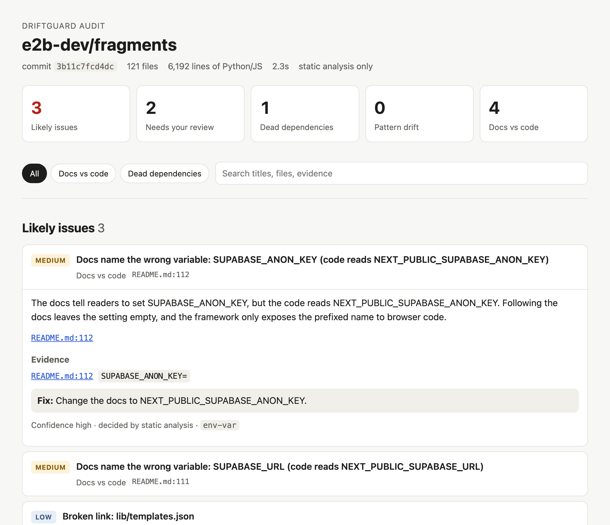

# DriftGuard

**Finds the mess AI coding assistants leave behind.** When different AI sessions write different parts of a codebase, nobody keeps the whole picture. The same job gets solved three ways, libraries pile up, and the docs describe code that has since changed. DriftGuard audits Python and JS/TS repos for that drift and tells you where it is.



*A real report. [fragments](https://github.com/e2b-dev/fragments)' README tells you to set `SUPABASE_URL`, but the code reads `NEXT_PUBLIC_SUPABASE_URL`. Following the docs leaves the setting empty. (**[Open the live sample report →](https://harishni-5.github.io/driftguard/sample-report.html)**)*

## What it finds

| Agent | Finds | Real example |
|---|---|---|
| **Pattern-Drift** | The same job done in different ways: competing libraries, copied code, and functions that do the same thing under different names | gpt-researcher sends a chat message to its API in four separate handlers, each with different timeouts and error handling |
| **Spec-Drift** | Docs that promise what the code doesn't do: broken links, commands that run deleted files, missing scripts, wrong variable names | gpt-researcher's `.claude/` notes for AI assistants still document `MAX_URLS_TO_SCRAPE`, which the code no longer has |
| **Dead-Dep** | Dependencies declared but never used | Unused packages left in `package.json` and `requirements.txt` after features were removed |

## Results

Every number below comes from hand-checking findings on public repos the tool was never tuned on. All verdicts, with a reason for each, are in [eval/final-check.md](eval/final-check.md).

**The LLM check for duplicated logic** (33 hand-labeled groups from 5 held-out repos):

| Measured | Result |
|---|---|
| Groups the LLM confirms as the same job | **82% precision, 82% recall**, vs 52% precision for word similarity alone |
| Effect of rewriting the prompt | Recall went from **31% to 82%**, and precision went up too |
| Cost with Groq's free tier | About 1-2k tokens for a small repo, **$0** |
| Code search (`ask`): right file in the top 5, 40 held-out questions | **85% hybrid**, vs 78% for keywords or vectors alone |

**Static "likely issues", hand-checked on two separate sets of AI-era repos.** The first set (22 repos) found the main false-alarm causes; after fixing them, a second set of 17 repos never used before measured the result:

| Check | First set: 22 repos | After fixes: 17 fresh repos |
|---|---:|---:|
| Unused dependencies | 61% (95/156) | **80%** (48/60 sampled) |
| Copied code | 56% (28/50 sampled) | **74%** (37/50 sampled) |
| Competing HTTP, icon and date libraries in product code | 94% (17/18) | **100%** (15/15) |
| Competing libraries, all kinds | 58% (21/36) | 62% (15/24) |
| Docs vs code: broken links, missing files and scripts | 44% (39/89) | 27% (17/62) |

The fixes (recognizing template folders, generated file copies, `pip freeze` files, more command-line tools, docs-site links and build outputs) worked for dependencies and copied code. **Docs vs code is the weak spot**: every new family of repos brings its own doc conventions. On the fresh set, translated docs-site pages in one repo caused 30 of the 45 false alarms. Treat its findings as leads until it's measured better. Every verdict, with a reason, is in [eval/final-check.md](eval/final-check.md) and [eval/fresh-check.md](eval/fresh-check.md).

"Needs your review" items are leads: about 1 in 7 sampled turned out to be a real problem (4/28 and 4/29 on the two sets).

## Quick start

You need JDK 21+, Python 3.10+, Node 22.18+ and git. Maven and npm packages aren't needed: the Maven wrapper and a vendored parser are included.

```bash
git clone https://github.com/harishni-5/driftguard.git
cd driftguard
./mvnw package
java -jar target/driftguard.jar audit https://github.com/e2b-dev/fragments --out report.html
```

On Windows, build with `.\mvnw.cmd package`. Run `java -jar target/driftguard.jar doctor` to check your setup.

That runs static analysis only, which is free and sends nothing anywhere. To let a free LLM check the ambiguous cases, set a [Groq key](https://console.groq.com/keys) first:

```bash
read -rs GROQ_API_KEY && export GROQ_API_KEY
java -jar target/driftguard.jar audit path/to/your/repo --out report.html
```

`read -rs` waits for you to paste the key without showing it on screen.

Options: `--out` (`.md`, `.html` or `.json`), `--no-llm`, `--llm` (`groq`, `gemini`, `ollama` or `claude`), `--model`, `--embed`, `--db`.

## Ask questions about a repo

`ask` answers questions about any repo from its own code, citing file and line:

```bash
java -jar target/driftguard.jar ask https://github.com/e2b-dev/fragments "How are users limited in how many requests they can send?"
```

It splits the repo into functions and doc sections, finds the most relevant ones with hybrid search (BM25 keywords plus embeddings, merged by reciprocal rank fusion), and has the LLM answer only from those excerpts. Citations that don't point at a real excerpt are dropped, and the model is told to say when the excerpts don't answer the question. Without an LLM (`--no-llm`) it prints the matching code.

Embeddings are free: `ollama pull nomic-embed-text` keeps everything local, or a `GEMINI_API_KEY` uses Gemini's free tier. With neither, search uses keywords only. Vectors are cached in SQLite by content hash, so a second run only embeds what changed.

The same search feeds the audit: Pattern-Drift can show the LLM where each similar function is called, and Spec-Drift names the likely new location of a file that a doc points at but that has moved.

## Use it on pull requests

Add this file as `.github/workflows/driftguard.yml` in your repo:

```yaml
name: DriftGuard
on: pull_request
permissions:
  contents: read
  pull-requests: write
jobs:
  driftguard:
    runs-on: ubuntu-latest
    steps:
      - uses: actions/checkout@v4
      - uses: harishni-5/driftguard@master
        with:
          fail-on: none   # or "likely" to fail the check when a PR adds likely issues
```

On every pull request it audits the base and the head, then posts one comment listing only the drift **that PR added**, plus anything it fixed. Later pushes update the same comment. Findings match by fingerprint, not line number, so moving code around doesn't count as new drift. The full HTML report is attached to the run as an artifact.

It runs static analysis only: no API key, nothing leaves the runner, and the same code always gives the same result. It uses the safe `pull_request` trigger and only parses the PR's code, never runs it. Pull requests from forks get a read-only token, so there the summary appears on the run page instead of as a comment.

## How it works

1. **Parse, never run.** The repo is parsed with Python's own `ast` module and a vendored Babel parser, and the facts land in SQLite.
2. **Static analysis first.** Each agent settles everything it can without an LLM. Copied code, broken links and unused imports are facts, not opinions.
3. **LLM only for what's left.** Ambiguous cases go to a free LLM. It can confirm or re-rank a finding, but **never delete one**, because free models are sometimes confidently wrong. Small local models are advisory only.
4. **Two kinds of results.** "Likely issues" were settled by static analysis or a confirmed LLM check. "Needs your review" are leads. The report always says which is which and why.

Details for each agent: [docs/how-it-works.md](docs/how-it-works.md).

### Design choices worth knowing

- **Measured on held-out data.** Prompt changes were judged on repos labeled before any model saw them, using [written labeling rules](eval/LABELING.md). The `eval` command reruns the whole test with any model.
- **Weak checks are demoted, not hidden.** When a check measured poorly on new repos, it moved to "Needs your review" rather than being tuned until the numbers looked good.
- **Free by default.** Auto mode tries Groq, then Gemini, then local Ollama. It never picks a paid API.
- **Traceable.** Every LLM call is stored with its prompt, answer, tokens and latency.

## Free LLM options

| Provider | Setup | Watch out for |
|---|---|---|
| **Groq** (recommended) | Free key from [console.groq.com/keys](https://console.groq.com/keys), set as `GROQ_API_KEY` | Daily limits. Function code leaves your machine. |
| **Gemini** | Free key from [aistudio.google.com/apikey](https://aistudio.google.com/apikey), set as `GEMINI_API_KEY` | Free-tier prompts may be used to improve Google's products, so avoid it for private code. |
| **Ollama** | `ollama serve`, then `ollama pull qwen2.5:3b` | Fully private, but small models answered too unreliably, so they're advisory only. |

Model names change often. If a default model has been retired, pass another with `--model`.

## Safety

The audited repo is treated as untrusted:

- Its code is parsed, never run. Helpers run from a temp folder, not from the repo.
- Symlinks aren't followed, and `.env` files and private keys are skipped, so they can't reach a prompt.
- Long key-like strings are masked before code goes to an LLM. That's a safety net, not a guarantee, so use `--no-llm` or Ollama for private code.
- Repo text sent to an LLM is marked as untrusted data, and verdicts are only accepted for items that were asked about.
- The HTML report escapes all repo text and loads nothing from the network.

## Tests

```bash
./mvnw test
```

138 tests, run on Linux and Windows in CI. They need Python and Node on your PATH but no API key: LLM clients are tested against a local fake server.

## Status and limits

Working: ingestion, the three agents, code search and `ask`, Markdown, HTML and JSON reports, the pull request Action, and the eval harnesses, for Python and JS/TS.

Known limits: docs vs code is the least reliable check (see Results); example apps produce most unused-dependency findings in big monorepos; a very large monorepo (CopilotKit) took 20 minutes; functions that do the same job in very different words are missed; Spec-Drift checks concrete things like links and commands, not prose claims like "supports PDF export"; Java repos aren't audited yet; code search misses questions worded very differently from the code ("share a link" vs `publish`). The full list is in [docs/how-it-works.md](docs/how-it-works.md#known-limits).

Built with Java 21, picocli, SQLite and Jackson. Embeddings from Ollama (`nomic-embed-text`) or Gemini; no vector database.
