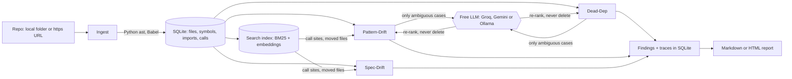

# How DriftGuard works

## The pipeline



1. **Ingest.** The repo is cloned (https only, no symlinks) or opened, and every Python and JS/TS file is parsed by a helper subprocess: Python's own `ast` module, and a vendored copy of Babel. The helpers read files and print facts. Nothing in the repo is ever run.
2. **Agents.** Each agent implements `AuditAgent`, gets the parsed repo plus an optional `LlmClient`, and returns findings. Agents run in a fixed order.
3. **LLM, only where needed.** Static analysis settles everything it can. The LLM only sees what's left, which keeps free-tier use small and results repeatable.
4. **Report.** Findings are split into "Likely issues" (static analysis or a confirmed LLM check) and "Needs your review" (leads a person should check).

Every LLM call is recorded in `agent_traces` with its prompt, answer, tokens, cost and latency, so any verdict can be traced back.

## Dead-Dep: unused dependencies

| Result | When | In the report |
|---|---|---|
| **Used** | Imported, run from a script or git hook, named in config, or implied by project files (`.tsx` files imply `react`) | Not shown |
| **Unused** (static) | No reference found anywhere in scope | Likely issue |
| **Ambiguous** | Could be used indirectly: a driver, a plugin configured under a short name, a dev tool run by hand, an import with an unknown owner | Sent to the LLM. If it says unused, it becomes a likely issue; otherwise it goes under "Needs your review" |

The LLM can re-rank a finding but never delete one, because free models can be confidently wrong.

## Pattern-Drift: the same job done different ways

It looks at non-test product code, one project at a time, so a frontend and backend in one repo aren't compared.

| Finding | How it's found | Needs an LLM? |
|---|---|---|
| **Competing libraries**, such as `axios` next to `fetch` | Imports and calls checked against a hand-written list of 19 common jobs | No |
| **Copied code** | Function bodies identical apart from formatting and comments | No |
| **Similar functions** | TF-IDF word similarity picks candidates, then an LLM checks whether they do the same job | To be confirmed, yes. Otherwise they're leads under "Needs your review" |

It skips what looks alike on purpose: framework-required names like `GET` or `loader`, UI components, and generated `components/ui` files. Functions in one file need a much stronger match, because neighbours are usually a family on purpose. Small local models are advisory: their opinion is shown, but it can't confirm a finding.

## Spec-Drift: docs that don't match the code

It reads the repo's Markdown docs (READMEs, `docs/`, and AI-assistant files like `.claude/` or `SKILL.md`) and checks what they tell readers to do against the code. It needs no LLM. Changelogs, proposals, RFCs and blog posts are skipped, because they describe the past or the future, not today's code.

| Finding | How it's found | Where it goes |
|---|---|---|
| **Broken link** | A relative link whose file doesn't exist. Site routes like `/docs/intro`, URLs and badge links that point outside the repo are skipped | Likely issue |
| **Command runs a missing file** | `python x.py`, `bash x.sh` or `./x.sh` in a shell block, following the doc's `cd` steps. Skipped after cloning another project or `cd`-ing outside the repo | Likely issue |
| **Missing script** | `npm run x`, `pnpm x` or similar where no package.json has a script `x` (a package's own command, like `pnpm vitest`, is fine) | Likely issue |
| **Docs name the wrong variable** | The docs say `SUPABASE_URL`, but the code reads `NEXT_PUBLIC_SUPABASE_URL` | Likely issue |
| **Variable never read** | The docs say to set a variable that no code, config or script mentions | Needs your review: docs often describe settings a separate tool reads |

## Code search and `ask` (RAG)

`dev.driftguard.rag` turns a repo into a searchable index:

1. **Chunking** (`Chunker`). Python and JS/TS are split along the parser's symbol table: one chunk per outermost function or method, a short header chunk per class, and windows for leftover module code. Docs are split by heading. Other code and config files get 60-line windows with 10 lines of overlap, and functions over 150 lines are windowed too. Templates, synced copies, lockfiles and files over 10,000 lines are left out.
2. **Keywords** (`Bm25`). Okapi BM25 over identifier-aware tokens: `getUserName` and `get_user_name` both index as `user`, `name` and the whole identifier, plus a light plural trim. Names and paths count double.
3. **Vectors** (`Embedder`, `HttpEmbedder`). Ollama's `nomic-embed-text` (local, with its `search_document:` and `search_query:` prefixes) or Gemini's `gemini-embedding-001` (768 dimensions, separate query and document modes). Vectors are cached in the `embeddings` table keyed by content hash and model. Search is a brute-force cosine loop, which takes milliseconds at repo scale.
4. **Hybrid ranking** (`RagIndex`). Reciprocal rank fusion (k = 60) of the top 100 keyword and vector results. Test files and fixtures get weight 0.7, because they repeat the words of the code they test and crowded it out of "how does X work" answers. If embedding fails, search falls back to keywords with a warning.
5. **Answering** (`Answerer`). The top 8 chunks, each clipped to 60 lines and with key-like strings masked, go to the LLM as numbered, untrusted sources (at most 16,000 characters, to fit free-tier limits). The model answers with citations like `[2]` and sets `answerable` to false when the sources don't cover the question. Citations to sources that don't exist are dropped.

**In the agents:**

- Pattern-Drift's prompt v3 adds `<context>`: up to 4 call sites of the group's functions and 1 doc mention, retrieved from the index (`RelatedCode`). Whether v3 beats v2 is measured on the held-out labels; the agent uses v2 until it does.
- Spec-Drift's `MovedFiles` names where a missing file probably went: a file with the same name elsewhere ("probably moved"), or a retrieved file with the same extension whose name contains the old name's words ("may have been renamed").

**Measured** with `driftguard eval-rag`, on hand-written questions whose answer files were noted by reading the code first:

| Set | Keyword top 5 | Vector top 5 | Hybrid top 5 | Hybrid MRR@10 |
|---|---:|---:|---:|---:|
| Dev: 50 questions, markitdown and ai-chatbot | 60% | 80% | 74% | 0.54 |
| Held-out: 40 questions, full-stack-fastapi-template and fragments | 78% | 78% | **85%** | **0.68** |

The dev questions deliberately avoid the code's own names, so vectors win there. The held-out set mixes in questions with names from config and error messages, as real questions have, and hybrid wins. The test-file weight was the only change made after looking at dev results; it raised dev top-5 from 62% to 74% for hybrid. Settings were fixed before the held-out set ran. Per-question ranks: [eval/results-rag-dev.md](../eval/results-rag-dev.md), [eval/results-rag-heldout.md](../eval/results-rag-heldout.md).

## Measuring accuracy

[eval/pattern-drift-labels.json](../eval/pattern-drift-labels.json) holds 50 similar-function groups from 7 repos, each labeled by hand before any LLM saw it, and pinned to the exact commit it came from. The `eval` command asks the LLM about every group and scores its answers:

```bash
java -jar target/driftguard.jar eval eval/pattern-drift-heldout.json --prompt v1,v2 --out eval/results-heldout.md
```

It reports precision (how many groups the model called drift really are drift), recall (how many real drift groups it caught), and the same precision for word similarity alone, as a baseline. To label new groups, add a repo to the file and run with `--dump`, which writes every group with its code and calls no LLM.

There are two label files:
- **`pattern-drift-labels.json`** (50 groups, 7 repos) is the development set. Prompt changes were made by looking at mistakes on it, so scores on it are optimistic for any prompt after v1.
- **`pattern-drift-heldout.json`** (34 groups, 5 other repos) was labeled with written rules ([eval/LABELING.md](../eval/LABELING.md)) before any model saw it. Quote this one.

The labels are one person's judgment. The line between "same job" and "same shape on purpose" is sometimes arguable, and every label has a note explaining it. Full results and the reasoning behind each change are in [DECISIONS.md](DECISIONS.md).

## Project layout

```
src/main/java/dev/driftguard/
  cli/        picocli commands (audit, ask, diff, eval, eval-rag, doctor)
  ingest/     clone or open a repo, walk files, run the parser helpers
  manifest/   read requirements.txt, pyproject.toml, Pipfile, setup.py, setup.cfg, package.json
  agents/     AuditAgent interface, Finding, and one package per agent
  llm/        LlmClient interface, provider selection, OpenAI-format client (Groq, Gemini, Ollama), Claude client
  rag/        chunking, BM25, embeddings, hybrid search, answering with citations, retrieval eval
  store/      all SQLite access, including the embedding cache
  report/     Markdown, HTML and JSON output, and the pull request comment
src/main/resources/
  helpers/    parser subprocesses: Python (ast) and Node (vendored Babel)
  db/         schema.sql
  knowledge/  PyPI name to import name table
```

**To add an agent:** implement `AuditAgent`, then add it to the list in `AuditCommand`. Agents get the parsed repo, an optional `LlmClient` and a trace sink, and they return findings. Tokens, cost and latency get recorded through the trace sink, so they land in `agent_traces`.

## Pull request mode

`action.yml` audits a PR's base commit and its head with `--out x.json`, then `driftguard diff base.json head.json` keeps only findings whose fingerprint is new. Fingerprints are built from file paths, names and the finding type, never line numbers. JSON output lists every Pattern-Drift group, not just the strongest 15, so a group dropping out of a top list can't look like a fix. Text from the repo is escaped in the comment, so a crafted file name can't @mention people, inject links or break the table.

## Known limits

- **Peer dependencies:** a package needed only as another package's peer looks unused. `shiki` under `rehype-pretty-code` is a real example. Lockfiles could fix this.
- **Curated tables:** `KnownPackages` and `python-import-names.txt` are hand-written and will never be complete. Unknown names go to review rather than being called unused.
- **Regex fallback:** files the parsers can't read fall back to a rough import scan, and findings in that scope get lower confidence.
- **Different wording:** Pattern-Drift's candidate search only compares words, so the same job written in very different words is missed. A test documents this. Code search has the same gap when a question's words differ from the code's: "how does sharing create a short link" misses `publish.ts`, which talks about `kv` and `nanoid`.
- **Error-handling style:** differences such as `.then` vs `await` aren't detected yet.
- **Feature claims in prose:** Spec-Drift checks concrete things (links, commands, scripts, variables), not sentences like "supports PDF export".
- **Scope:** Java repos aren't audited yet, and neither are multi-language dependency managers such as Bazel.
